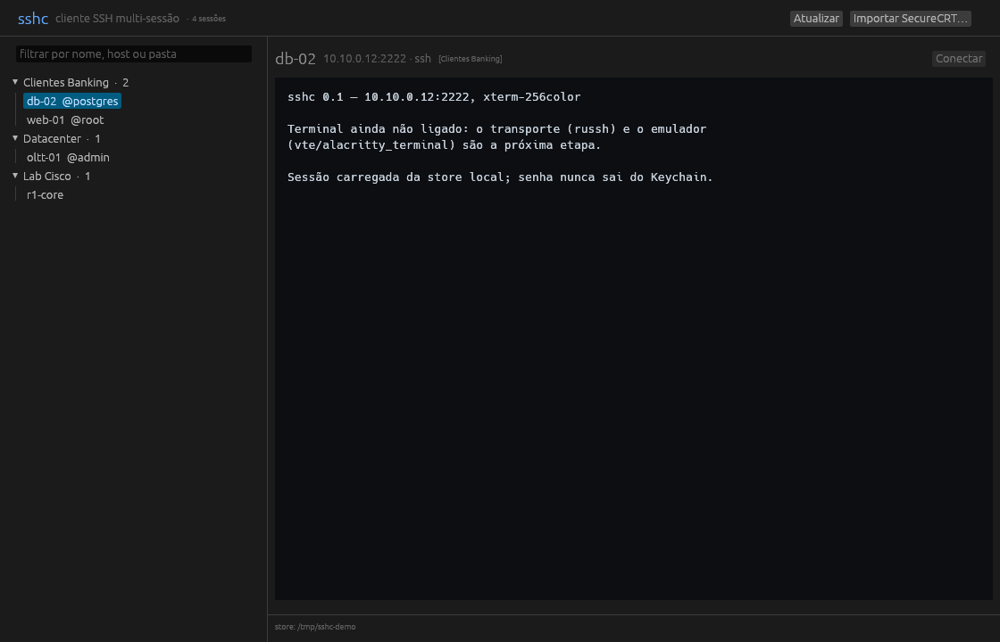
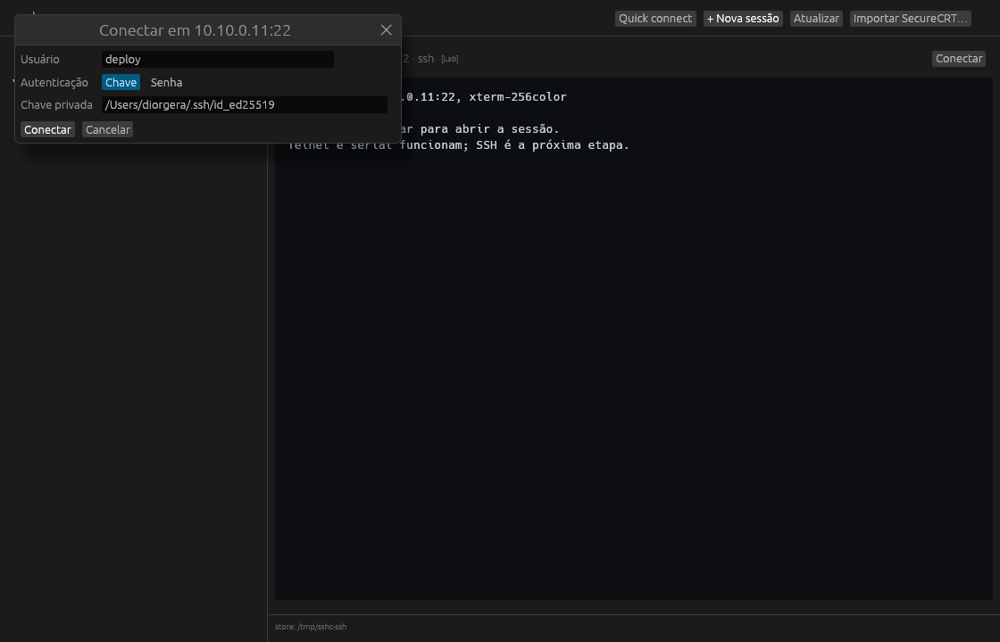
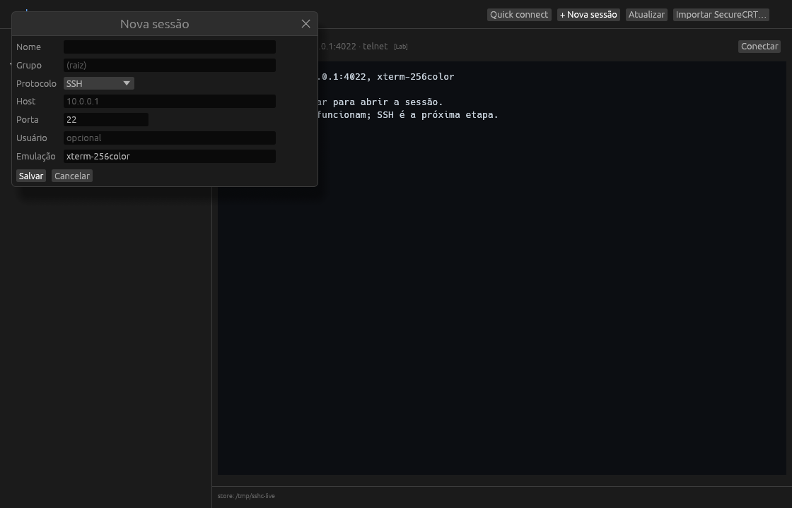

# sshc

[](https://github.com/diorgesl/sshc/actions/workflows/ci.yml)

Cliente SSH multi-sessão em Rust (protótipo). Marca provisória: `sshc`.

**Download:** [releases](https://github.com/diorgesl/sshc/releases) — instaladores
(`.dmg`, `setup.exe`, `.deb`) e binários (`.zip`/`.tar.gz`) gerados pelo GitHub Actions.

## Instaladores

| SO | Instalador | Binário |
|---|---|---|
| macOS | `sshc-macos-arm64.dmg` — arraste `sshc.app` para Applications | `sshc-macos-arm64.zip` (updater) |
| Windows | `sshc-windows-x86_64-setup.exe` — atalho + desinstalador | `sshc-windows-x86_64.zip` |
| Linux | `sshc_<versão>_amd64.deb` — `sudo apt install ./sshc_*.deb` | `sshc-linux-x86_64.tar.gz` |

Os instaladores não são assinados/notarizados: macOS e SmartScreen ainda avisam
na primeira execução. No macOS o **auto-update continua usando o zip**; o DMG é
para a instalação inicial.

## Sessões na nuvem: login Google

`sshc login` abre o navegador (OAuth 2.0 PKCE, loopback), você autoriza, e o
app grava as sessões num **app-data folder privado** do seu Google Drive
(`drive.appdata`): ele só enxerga os arquivos que ele mesmo criou — o resto do
Drive fica invisível, sem permissão de leitura.

Noutro PC: instala, `sshc login`, `sshc sync` — as sessões descem.

```bash
cargo run -- login --client-id <SEU_CLIENT_ID>   # guarda em ~/.sshc/client-id
cargo run -- sync --dry-run                      # mostra o que faria
cargo run -- sync                                # reconcilia
cargo run -- logout                              # apaga o token do Keychain
```

O refresh token fica no **Keychain do macOS**, nunca em arquivo.

### Criando o client ID (5 minutos, uma vez)

1. <https://console.cloud.google.com> → projeto novo (ex.: `sshc`)
2. **APIs & Services → Library** → ative **Google Drive API**
3. **OAuth consent screen** → External → preencha nome/email → Publishing status
   **Publish app** (o escopo `drive.appdata` não é sensível, não pede verificação).
   Se ficar em *Testing*, o refresh token expira em 7 dias.
4. **Credentials → Create credentials → OAuth client ID → Desktop app**
5. Copie o ID (`....apps.googleusercontent.com`):
   `sshc login --client-id <ID>`

Redirect usa loopback `http://127.0.0.1:<porta>`, permitido para clientes desktop.

## Backup no Telegram (documento fixado)

Sem projeto no Google Cloud: crie um bot com o **@BotFather** (`/newbot`), mande
`/start` para o bot e conecte pela janela **Telegram…** da GUI (ou pelo CLI). A
store inteira vira **um único documento** `sshc-sessions.json`, fixado no chat.

A Bot API não deixa listar o histórico do chat, então o `pinned_message` é o que
permite a outra máquina achar o backup. Cada backup substitui o documento
fixado; restaurar **não apaga** nada local — arquivo que já existe e difere vira
conflito em `conflicts-<hash>/` (o mesmo diretório do sync com o Drive).

```bash
cargo run -- telegram login --token <TOKEN>   # ou SSHC_TELEGRAM_TOKEN
cargo run -- telegram backup
cargo run -- telegram restore
cargo run -- telegram logout
```

O token do bot fica no **Keychain do macOS** (como o refresh token do Google;
Windows/Linux ainda não têm credential store). Sessões não levam senha: só
host, porta, usuário e emulação.

## Interface

```bash
cargo run -p sshc-gui
```



Árvore de sessões por pasta, filtro por nome/host/grupo, **seleção múltipla**
(⌘/Ctrl+clique e Shift+clique) com exclusão em lote, **abas** (várias sessões
abertas ao mesmo tempo, cada uma com seu terminal e seleção), teclado e
importação do SecureCRT pela própria janela (com seletor de pasta).

O painel esquerdo é o **Session Manager**: cabeçalho com contagem, toolbar
(nova, conectar, editar, duplicar, excluir, atualizar), filtro com **⌘I**
(Ctrl+I fora do macOS), ícone por pasta/sessão e rodapé "Pronto · N
selecionadas". O tema do app — **Sistema/Claro/Escuro** — fica no canto
direito da barra de status e a escolha é lembrada em `…/sshc/theme`; o
terminal mantém a paleta escura própria.

O app lembra **quais grupos ficaram abertos/fechados** (`…/sshc/groups`) e o
**tamanho da janela** (`…/sshc/window`). Como as sessões são abas de uma
janela só, o tamanho salvo é o da janela — não um por sessão.

**Conecta de verdade:** SSH (chave ou senha, PTY e resize), Telnet (filtro IAC
recusando opções) e Serial (porta + baud). A conexão abre numa thread — a janela
continua respondendo, mostra "conectando em …" e o TCP tem timeout de 10s.

Servidores antigos: se não houver **nenhum** algoritmo moderno em comum (OLTs
que só oferecem SHA-1), o cliente tenta de novo uma vez com KEX SHA-1,
AES-CBC/3DES e HMAC-SHA1 — e a barra de status avisa “compatibilidade legada
(SHA-1/CBC)”.
Servidor moderno negocia direto e nunca vê esses algoritmos.



**Senhas por sessão:** no diálogo de conexão, marque **"Salvar no Keychain"** —
a senha fica no Keychain do macOS (item `sshc-session`, chave
`host:porta:usuário`) e nas próximas conexões é usada direto, sem diálogo. Para
trazer várias de uma vez: **Importar senhas…**, uma por linha,
`host;senha` ou `host;usuário;senha`.

> O SecureCRT **não** permite exportar as senhas dele: elas ficam cifradas no
> `S:"Password V2"` (`03:82f0...`, 80 bytes) com esquema proprietário. Não tem
> como importar; o caminho é a lista acima ou digitar uma vez com "Salvar no
> Keychain" marcado.

**Autenticação automática, como o `ssh`:** tenta o **ssh-agent**
(`SSH_AUTH_SOCK`) e depois `IdentityFile` do `~/.ssh/config` +
`~/.ssh/id_ed25519`, `id_ecdsa`, `id_rsa`. Usuário vem da sessão, do
`~/.ssh/config` ou do usuário local, nessa ordem — só abre o diálogo (chave,
senha ou automático) se nada disso for aceito. **Senha e passphrase nunca são
gravadas.**

Chave protegida por passphrase: o cliente detecta, abre o diálogo já no modo
**Chave** com o caminho preenchido e pede só a passphrase.

A host key é verificada contra o `~/.ssh/known_hosts`; se for nova, é
registrada e a impressão digital aparece na barra de status (TOFU). Para usar
outro arquivo: `SSHC_KNOWN_HOSTS=/caminho`.

Um teste de fumaça abre, conecta num servidor Telnet local, salva a tela em
`/tmp/sshc-gui.ppm` e fecha — é assim que a captura acima é gerada.

### Adicionar conexões

| Como | O que faz |
|---|---|
| **+ Nova sessão** | formulário: nome, **grupo** (select das pastas), protocolo, host, porta (ou baud), usuário, emulação |
| **Quick connect** | conecta na hora, sem salvar nada |
| **duplo clique** na sessão | conecta direto (SSH usa agent/chaves; senha só se falhar) |
| **clique direito** na sessão | Editar · Duplicar · Excluir (com confirmação) |
| **Importar SecureCRT…** | traz as sessões do SecureCRT (com seletor de pasta) |
| arquivo `.toml` na store | `sshc where` mostra o caminho; pastas = grupos |

No formulário, **Grupo** é um select das pastas existentes. **“Nova pasta…”**
abre um campo para o nome; a pasta é criada ao salvar a sessão, e `/` faz
subpasta (ex.: `Clientes/OLTs`). O campo já vem com a pasta da sessão
selecionada.



Terminal: **scrollback** de 2000 linhas (roda do mouse; o cabeçalho mostra
"↑ N linhas" e clicar volta ao fim), **busca** com `Cmd+F` (Enter = próxima,
Shift+Enter = anterior, Esc fecha, contador `n/total`, ocorrência atual em
âmbar forte). Ao digitar, a visão volta pro fim. Se a sessão cair,
**ENTER** no terminal reconecta (como no SecureCRT).

A seleção é **absoluta**: atravessa o scrollback (arrastar além da borda rola a
tela), e **Cmd+A** seleciona tudo — histórico incluso. Copie com **Cmd+C**
(Ctrl+C fora do macOS);

**Log de sessão:** botão "Gravar log" no cabeçalho da aba — abre o diálogo nativo
pra escolher **pasta e nome** (sugere `<sessão>-<data>.log` e lembra a última
pasta). Grava o que chega do servidor em bytes crus, com escape (`cat -v` ou
`col -b` limpam).
cole com **Cmd+V** — quebras de linha viram CR e, se o shell pediu *bracketed
paste*, o texto é embrulhado em `ESC[200~`/`ESC[201~`.
TAB, setas e ESC pertencem ao shell; `Ctrl+C`/`Ctrl+D`/`Ctrl+Z` vão como código
de controle.

Modo smoke para CI/captura: `SSHC_GUI_SMOKE=1` abre, conecta na primeira
sessão, salva `/tmp/sshc-gui.ppm` e fecha sozinho. Com
`SSHC_GUI_SMOKE_FORM=1` abre o formulário, com `SSHC_GUI_SMOKE_TELEGRAM=1`
a janela do Telegram, com `SSHC_GUI_SMOKE_UPDATE=1` a de atualização e com
`SSHC_GUI_SMOKE_OFFLINE=1` nada conecta (só a UI).
`SSHC_THEME=light|dark|system` força o tema na captura.

## SFTP

O explorador SFTP abre a partir de uma aba **SSH**: botão **Abrir SFTP** no
cabeçalho do terminal. O botão não aparece em Telnet/Serial e não há entrada
própria no Session Manager — o SFTP nasce de uma aba SSH.

A aba `SFTP · <sessão>` tem **conexão própria**: uma segunda sessão SSH,
independente do terminal, então fechar ou desconectar uma não derruba a outra.
As credenciais que a aba de terminal usou ficam em memória e são reaproveitadas
sem novo prompt; sem elas, o app tenta o caminho automático (agent e chaves). Se
o servidor recusar, a aba mostra **Informar senha…** e o diálogo de autenticação
volta — com "Salvar no Keychain" funcionando. Nenhuma senha vai para o disco.
Clicar de novo em Abrir SFTP só foca a aba existente (uma por sessão).

**Duas panes.** Local à esquerda, remoto à direita, com divisória arrastável
entre 25% e 75%. Cada pane tem breadcrumb clicável (lápis ou `/` para digitar o
caminho; `~` vale dos dois lados), filtro por substring, subir, home, atualizar,
criar pasta e a ação principal (**Enviar…** / **Baixar…**). **Mostrar ocultos**
é global da aba. As panes mostram Nome, Tamanho e Modificado; a remota
acrescenta Modo (`drwxr-xr-x`) e symlink aparece como `nome → destino`. A
ordenação põe pastas primeiro; os estados "carregando…", pasta vazia e erro com
"Tentar de novo" são explícitos. O rodapé mostra contagem e seleção de cada pane
e a última mensagem; as transferências ficam num painel colapsável acima dele.

Atalhos com foco numa pane (⌘ = Ctrl fora do macOS):

| Atalho | Ação |
|---|---|
| Enter / duplo clique | pasta navega; arquivo remoto abre em **Editar**; arquivo local abre no app padrão |
| Backspace / ⌘↑ | sobe um nível |
| ⌘A | seleciona os itens visíveis |
| ⌘C / ⌘V | copia/cola entre as panes (clipboard interno) |
| Delete / ⌘⌫ | exclui com confirmação |
| `/` | edita o caminho da pane |

**Transferências.** Arraste linhas de uma pane para a outra (soltar sobre uma
pasta usa aquela pasta como destino) ou arraste do Finder/Explorer para a pane
remota; também há **Enviar…**, **Baixar…**, **Baixar para…** (escolhe a pasta
local) e o clipboard interno — ⌘C numa pane e ⌘V na outra (no mesmo lado ele
avisa para copiar para a outra). **Copiar caminho** usa o clipboard do sistema e
põe um caminho por linha.

A fila roda no worker com até **3 transferências simultâneas** por aba. Um job
é um arquivo ou uma pasta (a pasta vira um job com N arquivos e bytes). O painel
**Transferências** mostra barra de progresso, `i/N`, estado (na fila, ativa,
concluída, falhou, cancelada, interrompida), **×** para cancelar, **Tentar de
novo** (só jobs que **falharam**) para reenfileirar e **Limpar concluídas**; o
título da aba ganha `(N)` enquanto houver ativas. Download grava `.part` e só
assume o nome final ao terminar; cancelar ou falhar remove o `.part`. Upload
escreve direto (sem temporário no servidor na v1). Pasta de destino existente é
mesclada; **só arquivo** gera conflito. A transferência de pasta inclui o
conteúdo oculto mesmo que os ocultos estejam escondidos na lista; filtro e
ocultos só afetam a exibição.

**Conflitos.** Se o arquivo já existe no destino, um modal mostra origem e
destino com tamanhos e oferece **Sobrescrever**, **Renomear** (`nome (2).ext`,
`nome (3).ext`…) ou **Pular**, mais **aplicar a todos os conflitos deste job**.
É um modal por vez; o job fica pausado naquele arquivo até a resposta.

**Operações.** Criar pasta, renomear (inline), excluir com confirmação (pastas
remotas recursivas; local permanente, sem lixeira) e permissões. Links
simbólicos são exibidos e lidos (`nome → destino`), mas a v1 não cria links. Nas
transferências, o walk recursivo **nunca segue symlink** e conta "N links
simbólicos ignorados"; um symlink para arquivo selecionado sozinho é
transferido, mas link para pasta é recusado. Servidor que limita sessões
simultâneas (MaxSessions) ganha uma dica para fechar a conexão extra; servidor
sem subsistema SFTP mostra o erro na aba.

**Permissões** (só na pane remota): campo octal 000–777 e nove checkboxes rwx,
com prévia do modo; aplica aos selecionados e pastas **não** são recursivas.
Bits especiais (setuid/sticky) são preservados, não editáveis.

**Editar config remoto.** Duplo clique num arquivo remoto (ou menu Editar)
baixa a cópia para `<temp do SO>/sshc-sftp-edit/<sessão>/…` e abre no app padrão
do SO. O painel **Em edição** consulta a **cópia local** a cada 1 s e marca
**arquivo mudou** quando ela muda e estabiliza; o remoto só é conferido ao
enviar. O envio é sempre explícito: **Enviar de volta** (com confirmação se o
servidor também mudou desde o download), **Reabrir** abre de novo a cópia local
e **Descartar** apaga essa cópia — o app nunca envia sozinho. Cabem até 20
arquivos em edição; as pastas de sessão em `<temp do SO>/sshc-sftp-edit` sem
atividade há mais de 24 h são removidas na inicialização.

**Caminhos lembrados.** `…/sshc/sftp.json` guarda "mostrar ocultos", a posição
da divisória e os caminhos local/remoto por sessão (chave
`host:porta:usuário`). O caminho local só é usado se ainda for pasta; o remoto
é tentado e, se a listagem falhar, cai para o home com aviso. Filtros e seleção
não são persistidos, e o arquivo não contém senhas.

**Queda e reconexão.** Se a sessão cair, a aba mostra "conexão encerrada" e as
transferências ativas viram **interrompida**; **Reconectar** usa as credenciais
guardadas e volta ao caminho remoto salvo. A fila anterior **não é retomada**;
jobs **interrompidos** não têm "Tentar de novo" na v1 — envie os arquivos de
novo manualmente. Fechar a aba com transferência ativa pede confirmação e cancela
os jobs.

**Limites da v1.** Sem retomada de transferência (nem rsync, limite de banda ou
agendamento): o que foi interrompido precisa ser enviado de novo manualmente, e
um upload interrompido pode deixar arquivo parcial no servidor.
Sem *file promise*: um arquivo remoto **não aparece no Finder/Explorer** nem
pode ser copiado ou arrastado para fora do app — "Copiar caminho" copia texto.
Também não há cut/mover entre panes (só copiar/colar), chmod local ou recursivo,
favoritos, busca remota ou comparação de pastas. O SFTP exige uma aba SSH (sem
Telnet/Serial) e a listagem local é síncrona — um mount de rede pode segurar a
janela enquanto lista.

## Atualizações

Na inicialização o app consulta `releases/latest` no GitHub. A versão atual
aparece no canto direito da barra de status (`v0.4.0`) e vira
`↑ v0.4.1 disponível` quando há release novo — clicar abre a janela de
atualização (com “Verificar de novo”).

No **macOS arm64 rodando pelo `.app`**, “Baixar e reiniciar” baixa o zip,
confere o SHA-256 publicado pela API do GitHub, extrai com `ditto` e troca o
**bundle inteiro** por um helper que espera o app fechar e reabre. Trocar só o
binário quebraria a assinatura ad-hoc (o `Contents` é selado pelo
`CodeResources`). Precisa de permissão de escrita na pasta do app; se o app
estiver translocado (rodando de `Downloads`), mova para `/Applications`.
O updater baixa esse **zip**, não o DMG — o DMG é para a instalação inicial.

No Windows/Linux — e rodando via `cargo run` — a janela oferece **Abrir
release** para instalar manualmente. Não há substituição silenciosa: só depois
do clique. A primeira versão com updater precisa ser instalada à mão uma vez.

Para ver a UI de atualização sem esperar uma release nova:
`SSHC_UPDATE_FROM=0.3.3` simula uma versão antiga (o app encontra o v0.4.0
real). Nesse modo de teste a instalação fica desabilitada — sem ele, o
“Baixar e reiniciar” instala a última release de verdade.

## Layout local

```
~/Library/Application Support/sshc/
  sessions/                 # store: um .toml por sessão, pastas = grupos
    Cliente A/
      web-01.toml
  manifest-<hash>.json      # estado do sync DESTA máquina
  conflicts-<hash>/         # cópias que perderam conflito
  theme                     # system, light ou dark (seletor da barra)
  groups                    # grupos recolhidos (um por linha)
  window                    # largura x altura da janela
  sftp.json                 # SFTP: ocultos, divisória e caminhos por sessão
```

O manifesto e os conflitos ficam **fora** da store de propósito: se ficassem
dentro, e a store fosse uma pasta do iCloud, o PC B herdaria o estado do PC A.
`hash` = SHA-256 do caminho da store, então duas stores não se misturam.

`SSHC_SESSIONS` sobrescreve a pasta da store; `SSHC_STATE_DIR` o estado.

## Regras do sync

(Estas regras são do sync com o Drive; o Telegram é backup/restore — o último
backup vence.)

| Situação | Ação |
|---|---|
| só local mudou | upload |
| só remoto mudou | download |
| os dois mudaram | **local vence**; versão remota vai para `conflicts-<hash>/` |
| apagou local | apaga no Drive |
| apagou no Drive | apaga local (se não houve edição depois do último sync) |
| mesmo nome em dois PCs | local vence (Drive não deduplica nome) |

Credenciais de servidor **nunca** entram na nuvem — a sessão guarda só metadado
(host, porta, usuário, emulação); senhas ficam no Keychain da máquina.

## Uso local

```bash
cargo run -- where                       # store e estado em uso
cargo run -- import <Sessions-do-SecureCRT> --dry-run
cargo run -- import <Sessions-do-SecureCRT>
cargo run -- list
```

O importador lê o `.ini` do SecureCRT (`S:`/`D:`/`Z:`/`B:`) preservando host,
porta, protocolo, usuário, emulação, autenticação e descrição.
`__FolderData__.ini` é metadado de pasta e é ignorado. **Atenção:** o SecureCRT
grava os `D:` em hexadecimal com 8 dígitos (`00000016` = 22) — ler como decimal
dá porta 16 e nenhuma conexão funciona.

## Empacotar

```bash
./scripts/bundle-macos.sh      # .app + assinatura ad-hoc + .dmg (macOS)
./scripts/bundle-linux.sh      # .deb (Linux; precisa de dpkg-deb)
```

Windows: `scripts/sshc.iss` (Inno Setup 6). O CI instala o ISCC e gera o
`dist/sshc-windows-x86_64-setup.exe` junto do zip.

O ícone vem de `scripts/make_icon.py` (Pillow + `iconutil`), já versionado em
`assets/icon.icns`. A assinatura é **ad-hoc** — roda no seu Mac; distribuir pra
outros exige Developer ID + notarização, senão o Gatekeeper reclama.

## Estrutura

- `crates/core` — modelo, store, importador SecureCRT
- `crates/sync` — PKCE, OAuth, Drive v3 (appDataFolder), reconciliação e backup no Telegram
- `crates/net` — SSH, SFTP (ator, fila e transferências), Telnet (filtro IAC) e Serial
- `crates/term` — emulador VT sobre `vte` (cursor, erase, SGR 16/256/truecolor)
- `crates/cli` — binário `sshc` (onde, list, import, login, sync, telegram)
- `crates/gui` — app egui: Session Manager, terminal, explorador SFTP, temas e atualização pelo GitHub
- `scripts/bundle-macos.sh` / `bundle-linux.sh` / `sshc.iss` — `.dmg`, `.deb` e `setup.exe`

## Roadmap

1. **Split pane** (duas sessões lado a lado)
2. **Log/transcript** de sessão em arquivo
3. **Pageant** (Windows) e MFA keyboard-interactive
4. **Segurança**: Keychain por sessão/host; nada de senha em arquivo

## Licença

MIT.
